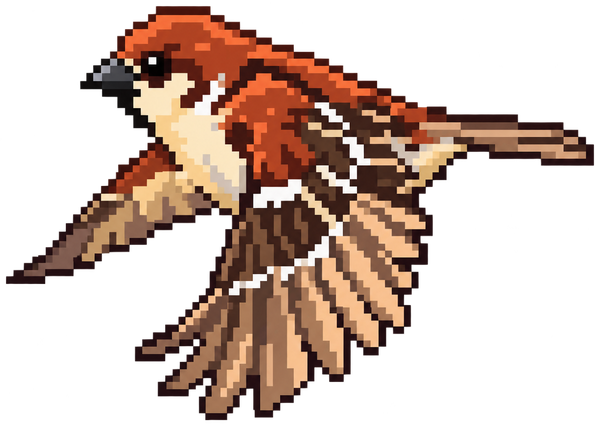
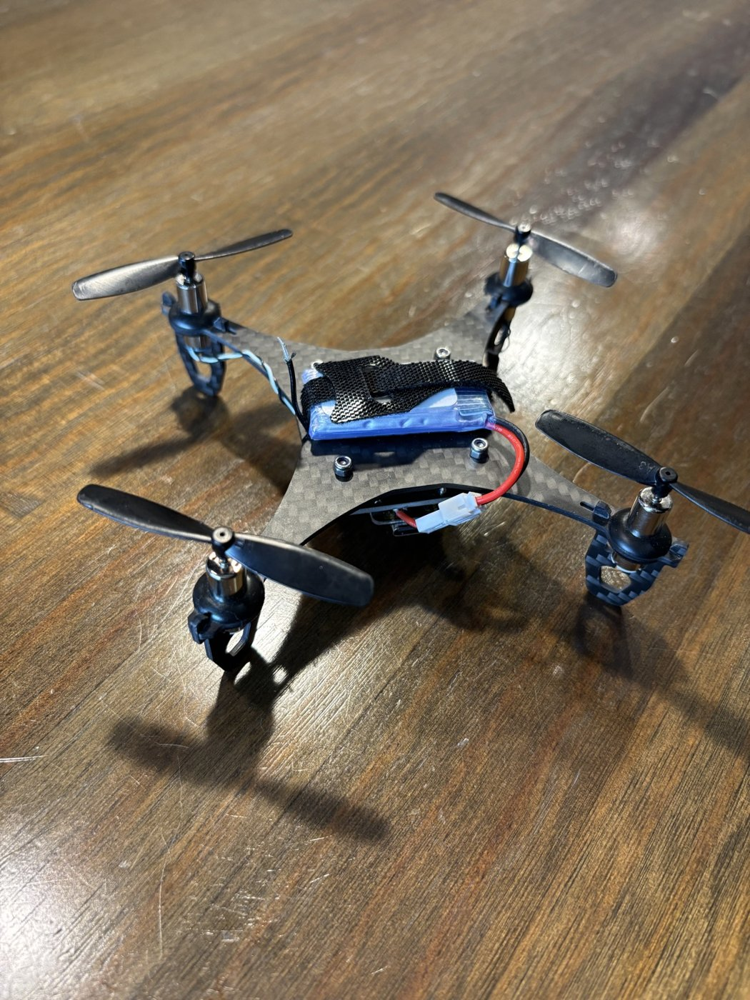
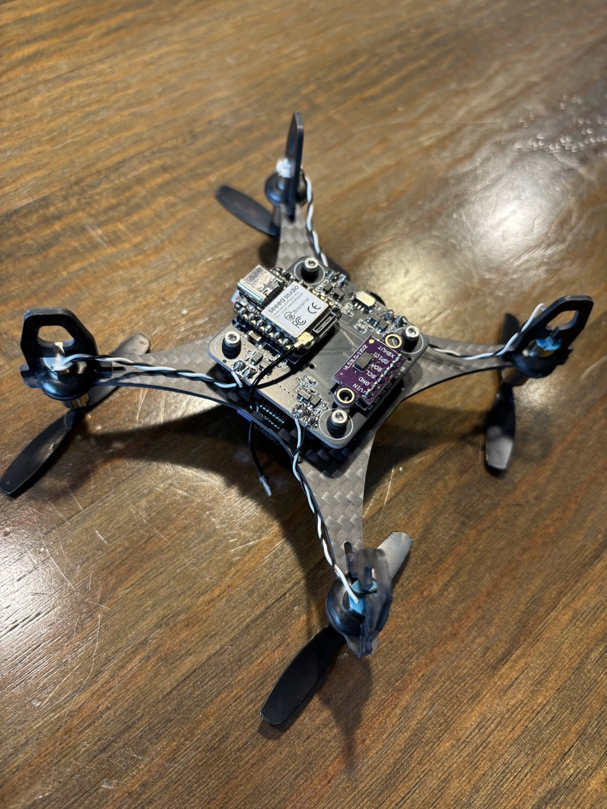
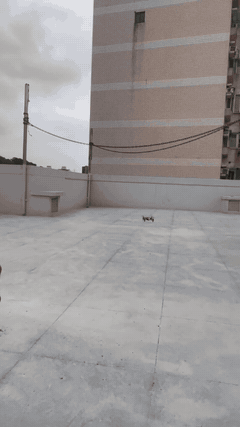
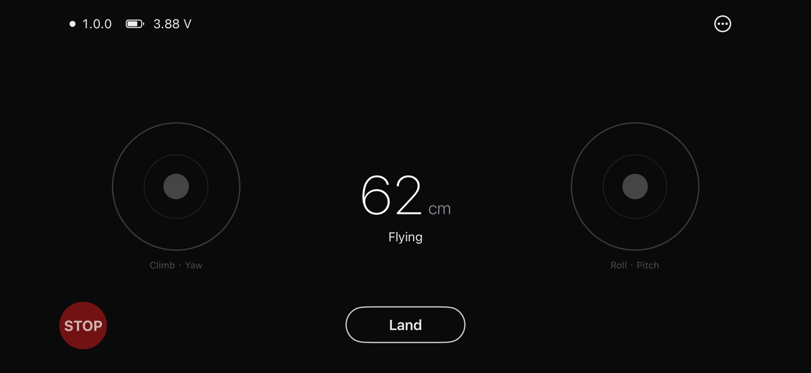

  

<h1 align="center">SparrowFlight</h1>

Build your own micro quadcopter

English | <a href="README.zh-TW.md">繁體中文</a>

SparrowFlight is a micro quadcopter platform designed to be built from widely available parts. Its drone, Sparrow, combines off-the-shelf modules (a Seeed XIAO ESP32-S3, a GY-521 IMU and a GY-530 time-of-flight sensor) with a two-layer flight controller that standard PCB services can manufacture and assemble, a carbon-fibre frame cut from a single 100 x 100 mm sheet, and common 720 coreless motors. It is intended for makers, students and educators who want a small drone they can build, understand and modify.

The frame, the flight controller and the firmware are being prepared for release under open licences; see [Project status](#project-status). Sparrow is flown with the iOS app SparrowFlight.

  
  

## Highlights

- **Off-the-shelf parts.** The microcontroller and the sensors are breakout modules sold by common electronics suppliers; the motors, propellers and battery are standard micro-drone parts.
- **Made to be manufactured.** The flight controller comes with a BOM and a placement file for assembly at JLCPCB; the frame is a single DXF for CNC milling.
- **Height hold.** A downward time-of-flight sensor holds the height above the surface below, and drives button take-off and automatic landing.
- **Phone control over WiFi.** The drone runs its own access point and advertises over Bluetooth, and it also accepts ESP-Drone's commander packets.
- **Flight log on board.** A blackbox records recent flights in flash for later analysis.

## Demo

Full clip (36 s): [docs/videos/test-flight.mp4](docs/videos/test-flight.mp4).

## Project status

| Component | Version | Status |
|---|---|---|
| Frame | 1.0 | flight-tested; design files in preparation for [hardware/](hardware/README.md) |
| Flight controller | 1.0 | flight-tested; design files in preparation for [hardware/](hardware/README.md) |
| Firmware | 1.0.0 | flight-tested; source in preparation for [firmware/](firmware/README.md) |
| SparrowFlight iOS app | 1.0.0 | awaiting App Store release; see [software/](software/README.md) |

The frame, the flight controller and the firmware will be published in this repository with their bills of materials and build instructions, under the licences listed in [LICENSE.md](LICENSE.md).

## Specifications

| | |
|---|---|
| Frame | 100 x 100 mm, 1.5 mm carbon fibre, snap-on landing gear |
| Flight controller | 40 x 40 mm, 2 layers, suspended under the frame on silicone grommets |
| MCU | Seeed XIAO ESP32-S3 Plus, or XIAO ESP32-S3 Sense for camera video |
| Sensors | MPU-6050 IMU (GY-521 module), downward VL53L0X time-of-flight rangefinder (GY-530 module) |
| Power | 1S LiPo with PH2.0 connector, TPS63020 buck-boost converter, slide power switch |
| Motors | 4 x 720 coreless brushed motors, 55 mm propellers, low-side MOSFET drivers |
| Link | WiFi access point on the drone, Bluetooth advertising for discovery |
| Flight time | about 3.5-4 minutes on a 400 mAh 20C battery |

## Parts

Sparrow is built from parts sold by common electronics and hobby suppliers. The flight controller board and the frame are made from the design files; see [Project status](#project-status).

| Part | Qty | Role |
|---|---|---|
| [Seeed XIAO ESP32-S3 Plus](https://wiki.seeedstudio.com/xiao_esp32s3_getting_started/) (or XIAO ESP32-S3 Sense), with its WiFi antenna | 1 | flight computer: reads the sensors, runs the control loop, drives the motors, and hosts the WiFi access point and Bluetooth; the Sense adds a downward camera |
| GY-521 module ([MPU-6050](https://invensense.tdk.com/products/motion-tracking/6-axis/mpu-6050/)) | 1 | 6-axis IMU (gyroscope and accelerometer) for the attitude estimate |
| GY-530 module ([VL53L0X](https://www.st.com/en/imaging-and-photonics-solutions/vl53l0x.html)) | 1 | downward time-of-flight rangefinder for height hold |
| 720 coreless brushed motor, 2 clockwise and 2 counter-clockwise | 4 | propulsion |
| 55 mm propellers for 1 mm shafts | 2 pairs | 2 clockwise and 2 counter-clockwise; spares recommended |
| 1S LiPo, 400 mAh, PH2.0 plug | 1 | power, about 3.5-4 minutes of flight |
| Rubber motor collars, M2 screws, nylon lock nuts, nylon washers and silicone grommets | 4 each | motor and flight controller mounting |
| Flight controller board, 40 x 40 mm | 1 | ordered from a PCB service, which assembles the power stage and the motor drivers |
| Carbon-fibre frame, 1.5 mm, 100 x 100 mm | 1 | CNC-milled from a single DXF |

The complete bill of materials will be published with the hardware.

## App

SparrowFlight for iOS discovers nearby drones over Bluetooth, joins the selected drone's WiFi network, and checks the drone before enabling the controls. It offers button take-off and landing or thrust-stick height control, shows the drone's camera behind the sticks, and edits flight parameters. A console and per-connection flight logs support tuning. The app collects no personal data.

Documentation: [app guide](software/README.md) and [privacy policy](software/PRIVACY.md).

## Support and contributing

For questions and problem reports, see [SUPPORT.md](SUPPORT.md). How to contribute is described in [CONTRIBUTING.md](CONTRIBUTING.md), and everyone taking part is expected to follow the [Code of Conduct](CODE_OF_CONDUCT.md).

## License

The documentation and photos are licensed under CC BY-SA 4.0. The frame (CC BY-NC-SA 4.0, adapted from [LiteWing](https://github.com/Circuit-Digest/LiteWing)), the flight controller (CERN-OHL-S-2.0) and the firmware (GPL-3.0) will be released under their own licences. The iOS app is not open source. See [LICENSE.md](LICENSE.md).

The names "SparrowFlight" and "Sparrow" and the Sparrow logo are not covered by these licences. Once the designs are published, derived versions may be built and shared under their licences, but must not be presented as official.
