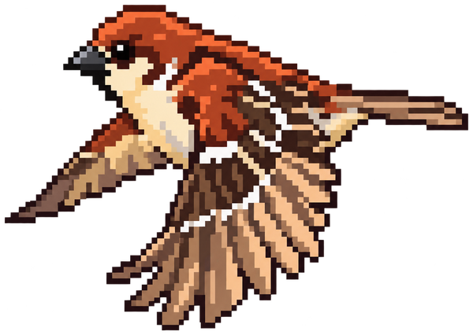
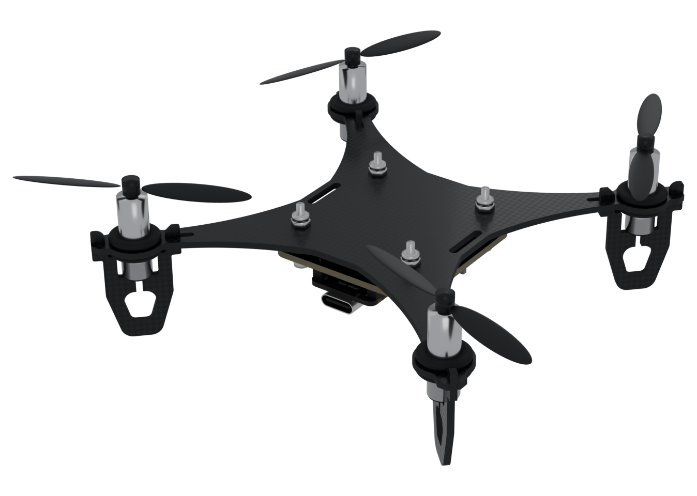
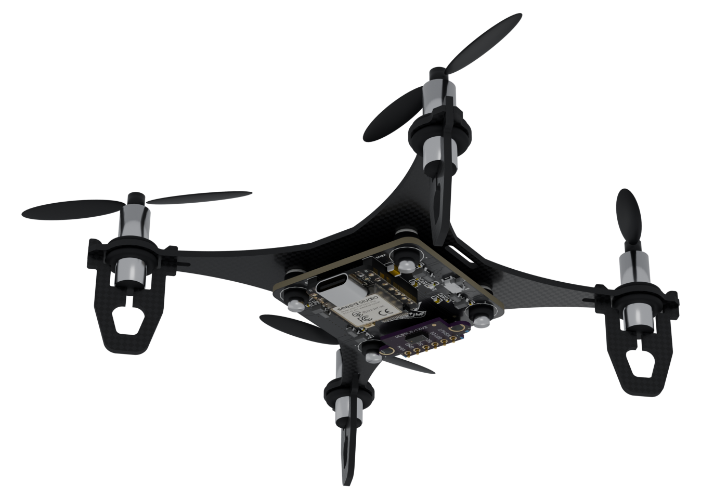
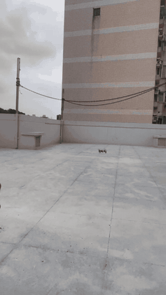
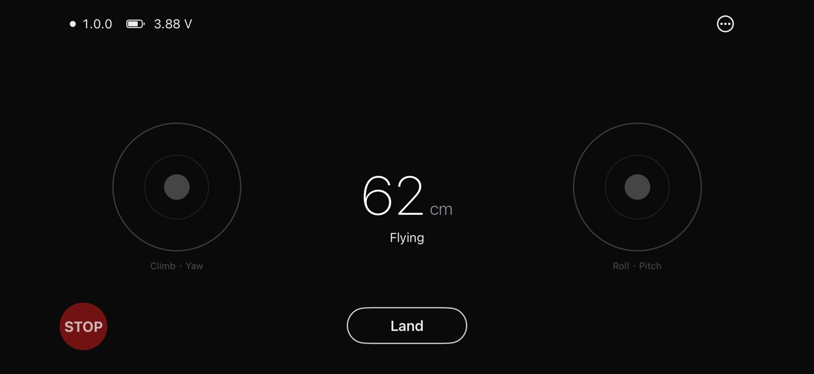

  

<h1 align="center">SparrowFlight</h1>

打造你的小型四軸無人機

<a href="README.md">English</a> | 繁體中文

SparrowFlight 是以容易取得的零件為設計前提的小型四軸無人機平台。它的無人機 Sparrow 由現成模組（Seeed XIAO ESP32-S3、GY-521 IMU、GY-530 ToF 測距模組）、可由一般 PCB 廠製作與組裝的 2 層飛控板、從單片 100 × 100 mm 碳纖維板切割的機架，以及常見的 720 空心杯馬達組成，適合想要親手組裝、理解並修改小型無人機的創客、學生與教育工作者。

飛控板（CERN-OHL-S-2.0）與韌體（GPL-3.0-or-later）為開源；機架改自 LiteWing，因此以非商業授權 CC BY-NC-SA 4.0 公開。設計檔、原始碼與組裝說明見 [hardware/](hardware/README.md) 與 [firmware/](firmware/README.md)。Sparrow 以 iOS App「SparrowFlight」操控。

  
  

3D 渲染圖，未包含天線、電池與電線。實機照片見 <a href="docs/photos/README.md">docs/photos</a>。

## 特色

- **現成零件**：主控與感測器都是一般電子零件通路販售的模組，馬達、螺旋槳與電池則是小型無人機的標準零件。
- **定高**：朝下的 ToF 測距維持離地高度，並用於按鈕起飛與自動降落。
- **手機 WiFi 操控**：無人機自建 WiFi 熱點並以藍牙廣播供 App 搜尋，也相容 ESP-Drone 的 commander 封包。
- **機上飛行紀錄**：黑盒子將最近幾次飛行記錄在 flash，供事後分析。

## 展示

完整影片（30 秒）：[docs/videos](docs/videos/README.md)。

## 規格與零件

Sparrow 使用一般電子零件與模型零件通路買得到的零件。飛控板由 JLCPCB 依 [hardware/flight-controller/](hardware/flight-controller/README.md) 的檔案製作並焊接，機架由碳纖維 CNC 加工廠依 [DXF](hardware/frame/README.md) 切割。

| 零件 | 規格 | 購買 |
|---|---|---|
| 機架 | 100 × 100 mm、1.5 mm 3K 碳纖維，四支卡扣式腳架，從單一 DXF 切割 | 蝦皮（碳纖維 CNC 加工） |
| 飛控板 | 40 × 40 mm、2 層；TPS63020 升降壓、滑動電源開關與四組低側 MOSFET 馬達驅動；以矽膠防震球掛在機架下方 | JLCPCB |
| [Seeed XIAO ESP32-S3 Plus](https://wiki.seeedstudio.com/xiao_esp32s3_getting_started/) | 飛行電腦，附 WiFi 天線：控制迴圈、馬達輸出、WiFi 熱點與藍牙；接上 XIAO ESP32-S3 Sense 的相機擴充板可加裝朝下相機 | 蝦皮 |
| GY-521（[MPU-6050](https://invensense.tdk.com/products/motion-tracking/6-axis/mpu-6050/)） | 六軸 IMU（陀螺儀與加速度計），用於姿態估算 | 今華電子 |
| GY-530（[VL53L0X](https://www.st.com/en/imaging-and-photonics-solutions/vl53l0x.html)） | 朝下的 ToF 測距，用於定高 | 今華電子 |
| 720 空心杯有刷馬達 | 7 × 20 mm、軸徑 1 mm；兩顆順時針、兩顆逆時針 | 今華電子 |
| 槳 | 55 mm、孔徑 1 mm，正反槳成對 | 蝦皮 |
| 電池 | 1S LiPo 400 mAh 20C、PH2.0 插頭；可飛約 3.5–4 分鐘 | 蝦皮 |
| 固定件 | O 型雙層護線圈（固定馬達，內徑 7 mm）、M2 × 14 mm 螺絲、M2 尼龍防鬆螺帽、2.6 × 5 × 1 mm 尼龍墊片、M2 矽膠防震球、綁電池用的尼龍束線帶 | 蝦皮 |

賣場：[JLCPCB](https://jlcpcb.com/)、[今華電子](https://www.jin-hua.com.tw/)、[蝦皮](https://shopee.tw/)，後兩者在台灣。

## 自己做一台

1. **機架：** 把 [DXF](hardware/frame/README.md) 交給碳纖維 CNC 加工廠，指定 1.5 mm 3K 碳纖維板。
2. **飛控板：** 用 [Gerber、BOM 與貼片座標檔](hardware/flight-controller/README.md#ordering-from-jlcpcb)向 JLCPCB 下單，含焊接。
3. **零件：** 照上表購買模組、馬達、槳、電池與固定件。
4. **組裝：** 把模組和馬達焊到飛控板上（[飛控板](hardware/flight-controller/README.md#assembly)），再把馬達和飛控板裝到機架（[機架](hardware/frame/README.md#assembly)）。
5. **韌體：** 用 PlatformIO 編譯，透過 USB 燒錄（[韌體](firmware/README.md#build-and-flash)）。
6. **飛行：** 安裝 [SparrowFlight](https://apps.apple.com/app/id6829419743)，照 [App 說明](software/README.md)操作。

## App

iOS 版 SparrowFlight 透過藍牙搜尋附近的無人機、加入所選無人機的 WiFi 網路，並在開放操控前檢查無人機狀態。支援按鈕起飛與降落，或以推力搖桿控制高度；可在搖桿後方顯示機上相機畫面，並編輯飛行參數。主控台與每次連線的飛行紀錄可協助調校。App 不收集任何個人資料。

可從 [App Store](https://apps.apple.com/app/id6829419743) 下載。文件：[App 說明](software/README.md)與[隱私權政策](software/PRIVACY.md)。

## 支援與貢獻

問題與回報請見 [SUPPORT.md](SUPPORT.md)。參與方式請見 [CONTRIBUTING.md](CONTRIBUTING.md)，所有參與者都應遵守[行為準則](CODE_OF_CONDUCT.md)。

## 授權

機架採用 CC BY-NC-SA 4.0（改自 [LiteWing](https://github.com/Circuit-Digest/LiteWing)），飛控板採用 CERN-OHL-S-2.0，韌體採用 GPL-3.0-or-later，各自資料夾內的說明文件與圖片也採用同一授權。其餘文件與照片採用 CC BY-SA 4.0。詳見 [LICENSE.md](LICENSE.md)。

「SparrowFlight」、「Sparrow」名稱與麻雀 logo 不在上述授權範圍內。可依授權製作並分享衍生版本，但不得宣稱為官方版本。
