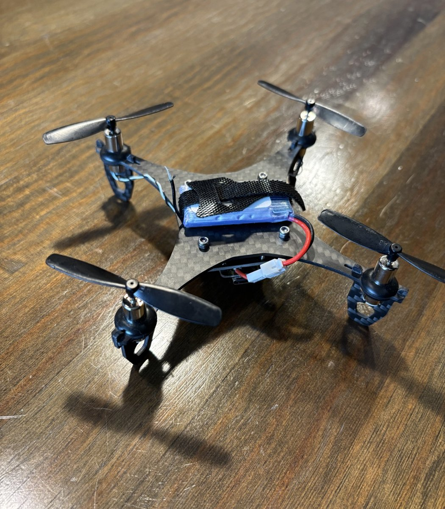
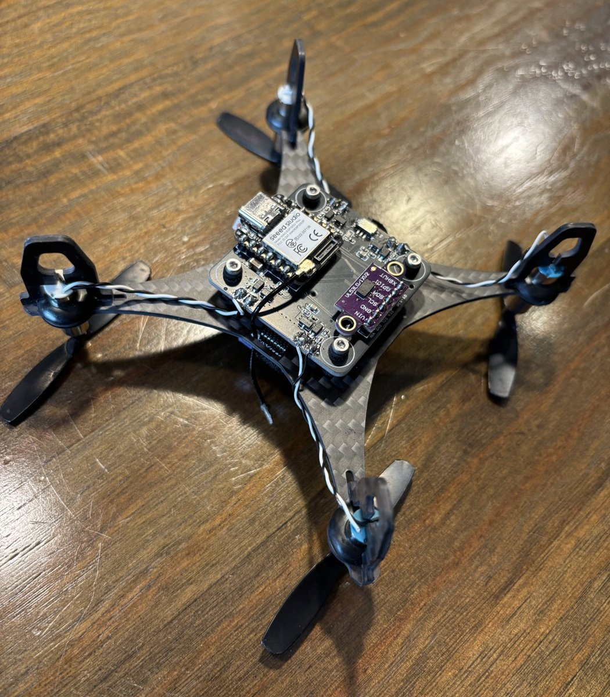
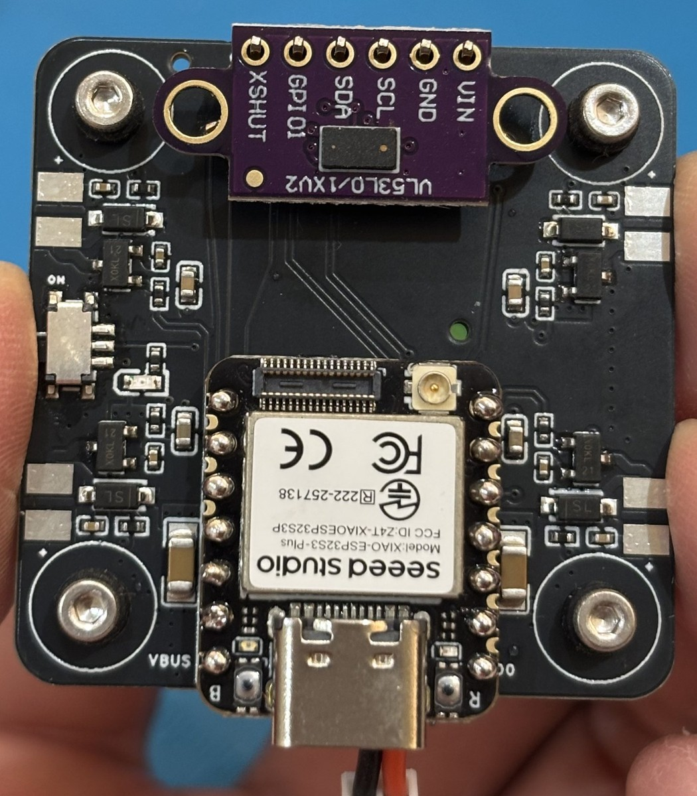

# Photos

Photos of the built Sparrow. The READMEs show 3D renders instead; these show the real parts.

  
  
  

From left to right:

1. Sparrow from the front, with the 1S battery strapped on top.
2. Sparrow from below, with the XIAO ESP32-S3 and the GY-530 ToF sensor on the flight controller.
3. The flight controller with the XIAO ESP32-S3 Plus and the GY-530.
