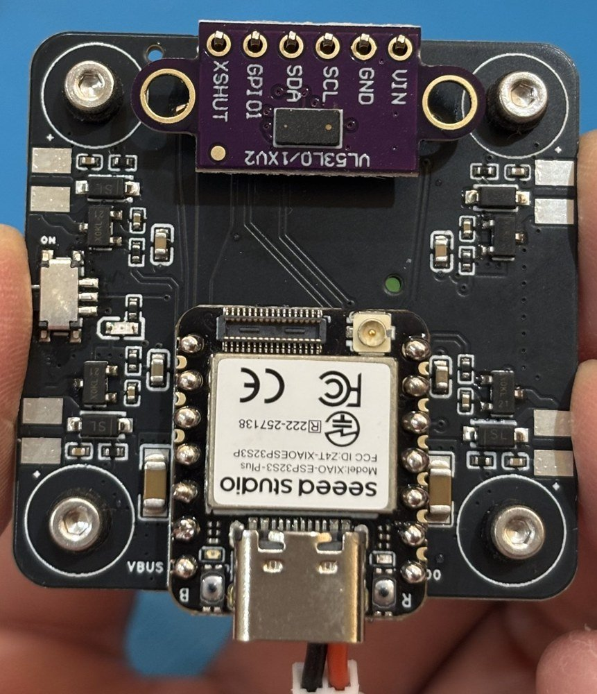

# Hardware

Sparrow's frame and flight controller. Their files will be published here.

| Part | Version | Files to be published | Licence |
|---|---|---|---|
| Frame | v1.0 | DXF for CNC milling, 1.5 mm carbon fibre | CC BY-NC-SA 4.0 |
| Flight controller | v1.0 | EasyEDA Pro source, schematic, Gerber, BOM, pick-and-place | CERN-OHL-S-2.0 |

**Frame:** 100 x 100 mm, 1.5 mm carbon fibre, with snap-on landing gear and four 720 coreless motors on 55 mm propellers. It is adapted from [LiteWing](https://github.com/Circuit-Digest/LiteWing) by Circuit Digest.

**Flight controller:** 40 x 40 mm, 2 layers, hung under the frame on silicone grommets. It carries a Seeed XIAO ESP32-S3 (the Sense version adds the camera), an MPU-6050 IMU on a GY-521 module, a downward VL53L0X ToF rangefinder on a GY-530 module, a TPS63020 buck-boost for the 1S battery, and low-side MOSFET drivers for the four brushed motors.

