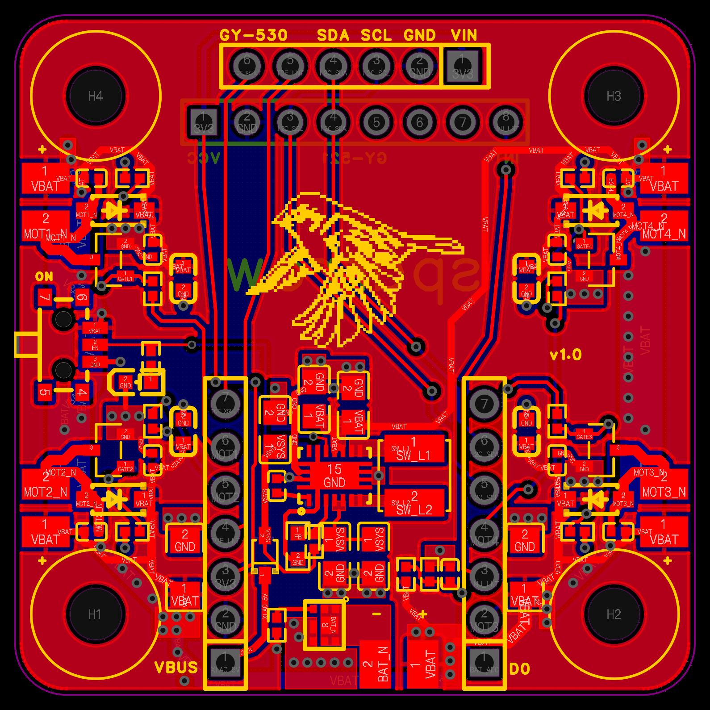
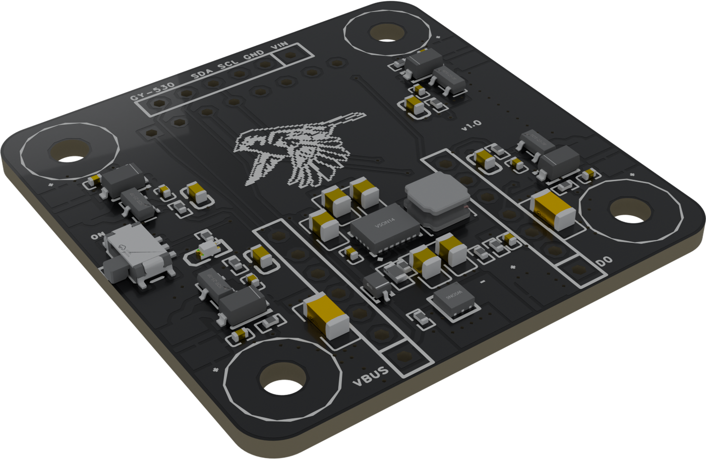
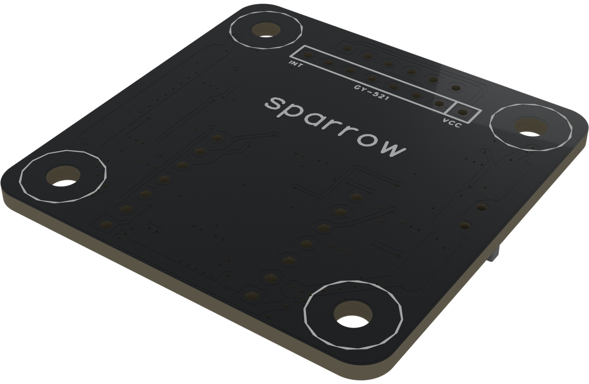

# Sparrow flight controller 1.0

A 40 x 40 mm, 2-layer brushed flight controller. JLCPCB assembles the power stage and the four motor drivers; you add three modules you can buy anywhere: a Seeed XIAO ESP32-S3 Plus, a GY-521 (MPU-6050) and a GY-530 (VL53L0X). The board hangs under the frame on silicone grommets, with the top side facing the ground.

## Layout and renders

  

The PCB layout in EasyEDA Pro, seen from the top side: top copper in red, bottom copper in blue, silkscreen in yellow.

The board as JLCPCB delivers it, without the modules, headers and wires, rendered from the EasyEDA Pro 3D export:

| Top (faces the ground) | Bottom (faces the frame) |
|---|---|
|  |  |

## Files

| File | Contents |
|---|---|
| [`sparrow-fc-v1.0.epro2`](sparrow-fc-v1.0.epro2) | EasyEDA Pro project (schematic and PCB); open it with File > Open in EasyEDA Pro |
| [`sparrow-fc-v1.0-schematic.pdf`](sparrow-fc-v1.0-schematic.pdf) | schematic, 3 pages: power, MCU and sensors, motors |
| [`sparrow-fc-v1.0-gerber.zip`](sparrow-fc-v1.0-gerber.zip) | Gerber and drill files |
| [`sparrow-fc-v1.0-bom.csv`](sparrow-fc-v1.0-bom.csv) | BOM for JLCPCB assembly (LCSC part numbers) |
| [`sparrow-fc-v1.0-cpl.csv`](sparrow-fc-v1.0-cpl.csv) | pick-and-place file for JLCPCB assembly |

## Board

| Item | Value |
|---|---|
| Size | 40 x 40 mm, R3 corners, 2 layers, 1.6 mm FR-4 |
| Version marking | "v1.0" on the top silkscreen, on the edge opposite SW1 |
| Mounting | 4 x 3.0 mm holes on a 30.5 x 30.5 mm pattern, for M2 silicone grommets |
| Top side (faces the ground) | all assembled parts, XIAO ESP32-S3 Plus (J2, J3) with its USB-C at the front edge, GY-530 at the rear edge (J9), slide switch SW1 on the left edge |
| Bottom side (faces the frame) | GY-521 soldered flat (J4) |
| Battery | 1S LiPo on the J1 wire pads (solder a PH2.0 pigtail); Q6 blocks a reversed battery |
| Power | TPS63020 buck-boost makes 4.67 V, fed through D7 into the XIAO's 5V pin; the XIAO's own regulator makes 3.3 V for the sensors |
| Switch | SW1 switches the TPS63020 enable, not the motor current; LED D2 lights when SW1 is on and a battery is connected |
| Motors | 4 low-side drivers (AO3400A, B5819W flyback diode) on wire pads J5-J8 |

### XIAO pins

| XIAO | GPIO | Signal |
|---|---|---|
| D0 | 1 | battery voltage / 2 (ADC) |
| D1 | 2 | M3 front right |
| D2 | 3 | IMU interrupt |
| D3 | 4 | M4 rear right |
| D4 | 5 | I2C SCL |
| D5 | 6 | I2C SDA |
| D6 | 43 | not connected |
| D7 | 44 | ToF XSHUT |
| D8 | 7 | M1 rear left |
| D9 | 8 | M2 front left |
| D10 | 9 | ToF interrupt |

SCL and SDA are swapped against the Arduino default (`Wire.begin(6, 5)`); this keeps the I2C traces from crossing. I2C addresses: MPU-6050 0x68, VL53L0X 0x29. The board has no I2C pull-ups of its own; the modules provide them.

> **USB and the battery.** Turn SW1 off before you connect USB. The XIAO's 5V pin and its USB-C VBUS are the same net: with SW1 on, the board already drives VBUS and the computer does not enable the port. The battery may stay plugged in. When the firmware sees a computer on USB, at boot or later on the ground, it does a dry run: the motor pins stay low.
>
> A USB charger or power bank is not a computer. With a battery connected, even with SW1 off, the board then boots as on battery: after 3 s of LED warning each motor spins in turn. Keep clear of the propellers, or unplug the battery before you use a charger.

## Ordering from JLCPCB

1. Upload `sparrow-fc-v1.0-gerber.zip`: 2 layers, 1.6 mm.
2. Turn on PCB Assembly: Economic, top side.
3. Upload `sparrow-fc-v1.0-bom.csv` and `sparrow-fc-v1.0-cpl.csv`. JLCPCB places 49 parts (19 BOM lines). The connectors J1-J9 are not assembled; they are the pads and holes for the modules, battery and motors.

## Parts to buy

| Part | Quantity |
|---|---|
| Seeed XIAO ESP32-S3 Plus (comes with an FPC antenna) | 1 |
| GY-521 MPU-6050 module | 1 |
| GY-530 VL53L0X module | 1 |
| 720 coreless brushed motor, 2 clockwise and 2 counter-clockwise | 4 |
| 55 mm propellers for 1 mm shafts, 2 clockwise and 2 counter-clockwise per drone (buy spares) | 2 pairs |
| O-type double-flanged cable grommets as motor collars, 7 mm inner diameter, for 9 mm holes | 4 |
| 1S LiPo 400 mAh with PH2.0 plug, and a PH2.0 pigtail | 1 |
| Nylon cable tie for the battery (it goes through the frame's 2.2 x 12 mm slots and between the frame and the GY-521) | 1 |
| M2 x 14 mm screws, M2 nylon lock nuts, 2.6 x 5 x 1 mm nylon washers, M2 silicone grommets | 4 each |
| 2.54 mm pin headers (two 1 x 7 for the XIAO if not included, one 1 x 6 for the GY-530) | |

## Assembly

1. **GY-521 on the bottom.** Solder the straight header into the module from its back, then pull off the plastic spacer. Put Kapton tape on the board under the module, push the long pins through J4 from the bottom so the module lies flat, and solder on the top side. Trim the pins. Do not use foam: the IMU must be rigid.
2. **Battery pigtail.** Solder a PH2.0 pigtail to the J1 pads (marked + and -) now: they sit under the XIAO.
3. **XIAO on the top.** Solder the XIAO's headers directly into J2 and J3, with the USB-C connector toward the front edge: the XIAO's USB end is the nose. Do not use sockets (see Known issues).
4. **GY-530 at the rear edge.** Saw off its mounting ears if needed, keeping at least 1.2 mm beyond the outer pins. Solder a 6-pin header into J9 with the sensor facing the ground, and add a dot of hot glue on the far side.
5. **Motors.** Seen from above with the nose (the USB end) ahead: M3 front right and M1 rear left spin counter-clockwise, M4 rear right and M2 front left spin clockwise. Solder each motor to its pad pair (J5-J8), positive lead on the pad marked +, and check the spin direction before fitting propellers.
6. **Antenna.** Click the FPC antenna onto the XIAO's U.FL connector and mount it upright on the outside of a landing-gear leg, away from the battery and the board. Without the antenna the WiFi link drops at high throttle.
7. Mount the board under the frame (see the [frame README](../frame/README.md)) and flash the [firmware](../../firmware/).

For a camera, fit the expansion board of a XIAO ESP32-S3 Sense to the XIAO ESP32-S3 Plus; the [firmware](../../firmware/README.md#camera) streams its camera to the app, and on this board it looks straight down. On the Plus the expansion board works with its J3 jumper left as it is. A whole XIAO ESP32-S3 Sense also fits in place of the Plus, but then cut the J3 jumper on its expansion board first: on the Sense it pulls up D9 and D10, which drive a motor and read the ToF here, and the microSD slot cannot be used.

## Known issues

- The IMU and ToF lose I2C readings when the XIAO sits in sockets and moves. Solder the XIAO directly into the board.
- Standard JST PH connectors are rated for about 2 A, while four motors at full throttle draw several amps. Check the battery lead for voltage drop and heat.

## Licence

[CERN-OHL-S-2.0](LICENSE). You may make, modify and sell these boards; if you distribute boards or modified designs, make the complete design sources available under the same licence.
