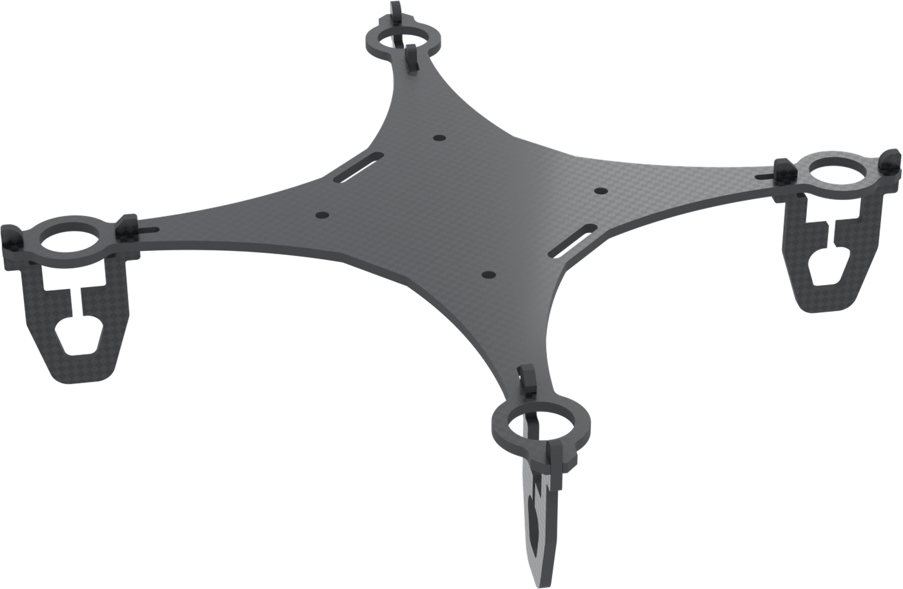
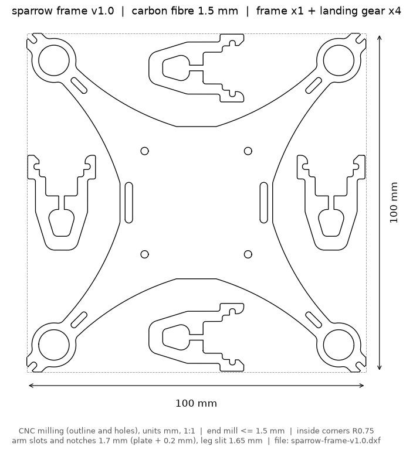
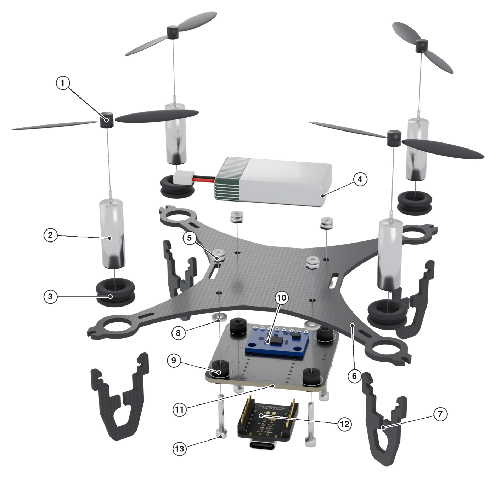

# Sparrow frame 1.0

A 100 x 100 mm quadcopter frame CNC-milled from 1.5 mm carbon fibre, with four snap-on landing-gear legs and no electronics. The flight controller hangs under the frame on four silicone grommets.

File: [`sparrow-frame-v1.0.dxf`](sparrow-frame-v1.0.dxf) (units mm, 1:1, every line is a cut). The frame and its four legs are nested in one 100 x 100 mm sheet.

## Geometry

| Item | Value |
|---|---|
| Plate | 1.5 mm 3K carbon fibre |
| Motor rings | closed 9 mm rings for 720 coreless motors |
| Openings (arm slot, motor-ring notch, leg clip) | 1.7 mm (plate thickness + 0.2 mm) |
| Inside corners | R0.75, so any end mill up to 1.5 mm can cut them |
| Leg flex slit | 1.65 mm (the narrowest slot a 1.5 mm end mill can cut) |
| Leg fit | about 0.01 mm interference at the plate faces; the legs snap on, no glue |
| Flight-controller holes | 4 x 2.2 mm on a 30.5 x 30.5 mm pattern, for M2 screws |
| Battery-strap slots | 2.2 x 12 mm at x = +-19.9 mm, for the cable tie that holds the battery |
| Leg reach | 23.8 mm below the frame |

The leg slit is required. The two clip notches face each other, so a rigid leg cannot get onto the frame; the legs spread about 1.6 mm while snapping on.

The leg fit depends on the plate thickness. If your plate is not exactly 1.5 mm, measure it and make the openings plate + 0.2 mm before ordering.

## Ordering

Send the DXF to a CNC shop that cuts carbon plate. Ask for 1.5 mm 3K carbon fibre and an end mill of 1.5 mm or less.

## Assembly

1 propeller, 2 motor, 3 motor collar (O-type double-flanged cable grommet), 4 battery, 5 M2 nylon lock nut, 6 frame, 7 landing-gear leg, 8 nylon washer, 9 silicone grommet, 10 GY-521, 11 flight controller, 12 XIAO ESP32-S3 Plus, 13 M2 x 14 mm screw. The cable tie, the antenna and the wires are not shown.

1. Snap each landing-gear leg into its arm slot and motor-ring notch. Spread the two prongs slightly until they click over the frame.
2. Push the motors into the 9 mm rings, each in an O-type double-flanged cable grommet.
3. Mount the flight controller under the frame. Each corner, from the ground up: M2 x 14 mm screw with its head under the board, silicone grommet (the board sits in its groove), 1 mm nylon washer, frame, and the M2 nylon lock nut on top of the frame. Tighten the four nuts evenly and stop before the grommets flatten. The washers keep about 4 mm between the frame and the board.
4. Tie the battery on top of the frame with a nylon cable tie: down through one strap slot, across under the frame between the frame and the GY-521, and up through the other slot.
5. Keep the WiFi antenna away from the carbon fibre, battery and board. Mount it upright on the outside of a leg.

Motor order and spin, with the nose (the flight controller's USB end) at +y: M3 front right and M1 rear left spin counter-clockwise, M4 rear right and M2 front left spin clockwise (the Crazyflie convention).

## Licence

The frame is adapted from LiteWing by Circuit Digest and is released under [CC BY-NC-SA 4.0](LICENSE). You may copy and modify it, but you must credit the sources, you may not use it commercially, and you must share your changes under the same licence. See [ATTRIBUTION.md](ATTRIBUTION.md).
